**GETTING STARTED**
# **REGISTRATION AND SETUP**

---

## **i. Before you begin**


!!! note ""
    Christopher Bienko *(AI Enablement GTM Product Manager)* provides an overview of the *Registration and Setup* module for the hands-on enablement. **<a href="https://ibm.seismic.com/Link/Content/DCRhBB6FPqR2jGqPHXCJgGXb4243" target="_blank">[1 min]</a>**

Before you begin the hands-on modules, complete the registration and setup steps below. By the end you will have an authenticated **IBM Bob** account entitled to the **IBM Bob Premium Package for i** (PPi), and an IBM i 7.6 partition that holds the *Flight400* demo application used in every module. 

The hands-on work ahead assumes you have completed the core curriculum of the *Climbing the AI Maturity Curve* L3 course, or that you hold equivalent familiarity with the Bob IDE and the Agentic Sidebar as well as Rules and AGENTS.md. No prior IBM i experience is required: the *Setup* chapter provisions the partition for you, and the modules explain each IBM i concept where it first appears.

---

What you ***do*** need:

!!! success "LAB PREREQUISITES"
    - **IBM Bob** installed and authenticated on your local machine
    - Your **IBMid** credentials are at hand (IBM regular employees sign in with their w3id)
    - **IBM regular employees:** access to the **<a href="https://w3.ibm.com/w3publisher/bob/addons" target="_blank">w3 add-ons portal</a>** to request the Premium Package for i entitlement
    - **Business Partners:** access to **IBM Technology Zone** to request the Premium Package for i entitlement
    - Access to **IBM Technology Zone** to reserve an *IBM i 7.6* virtual machine from the *Certified PowerVS Base VMs* collection, which takes 30 to 60 minutes to provision
    - The two Flight400 distribution files, **`FLGHT400.FILE`** and **`Install-Flight400.sql`**, downloaded from the links in the *Setup* chapter
    - A local folder is available to serve as your Bob project workspace, and an SSH client is installed (macOS, Linux and Windows 10 or later include one)

!!! info "MANAGING CONSUMPTION OF *BOBCOINS*"
    The Premium Package requires agentic AI capabilities, which consume Bob Resource Units (Bobcoins). The architecture overview in Module 1 and the RPG modernization in Module 2 are the most expensive prompts in this lab. The `AGENTS` member and the Understand scan exist to lower that cost: once they are in place, Bob answers structural questions from metadata instead of re-reading source members. Finish each module's prompts before you experiment with the optional variations.

---

The work proceeds in six stages:

- Request the **Premium Package for i** entitlement through the route that matches your job role, then confirm it has landed in your Bob account
- Install the **IBM Bob Premium Package for i** extension and the **IBM i Development Pack** from the Extensions view
- Reserve an **IBM i 7.6** virtual machine from IBM Technology Zone and download the Flight400 distribution files
- Create a local project workspace and connect Bob to the partition over SSH
- Have Bob install `tn5250` on the partition so that a **5250 terminal** opens inside the IDE
- Upload the Flight400 save file to the IFS, restore it into the `FLGHT400` library and add that library to your library list

Afterwards, you will be ready to begin <a href="https://bienko.github.io/bob-ppi/1-1/" target="_blank">**Module 1 | Analyze**</a>.

---

## **ii. Request entitlements to Bob Premium Package for i**

!!! warning "THIS LAB REQUIRES THE PREMIUM PACKAGE FOR i"
    Without the **IBM Bob Premium Package for i** (PPi) entitlement, IBM Bob can still open and read RPG, CL and DDS source, but the *IBM i Developer* and *IBM i Database* modes and the specifically-trained capabilities that the package provides will be unavailable. If neither mode appears in your Agentic Sidebar by the end of this chapter, the entitlement has **not** been linked to your Bob account.

Before Bob can operate against IBM i, you will want to request license entitlements to **IBM Bob Premium Package for i** (PPi). The pathway for doing so differs depending on your role as either an IBM regular employee or a business partner.

Without such entitlements, IBM Bob will still attempt to work with IBM i and RPG application code, though without the specifically-trained models and capabilities that PPi offers. For example, if your Agentic Sidebar shows no *IBM i Developer* mode in its mode selector, that indicates that your IBM Bob account has **not** been linked to the PPi entitlement.

---

Select from one of the two options below, according to your job role, to register for **IBM Bob Premium Package for i** entitlements:

??? info "IBM REGULAR EMPLOYEES"
    Request access via the following link: **<a href="https://w3.ibm.com/w3publisher/bob/addons" target="_blank">https://w3.ibm.com/w3publisher/bob/addons</a>**

    Once registered, *IBM Bob Premium Package for i* capabilities will automatically be authorized and connected to your IBM Bob account. No additional configuration or PPi-specific logins are required.

??? info "BUSINESS PARTNERS"

    1. Requests for PPi licensing entitlements can be made via **IBM Technology Zone**. Visit the following collection to begin the process:

        !!! warning ""
            **URL: <a href="https://techzone.ibm.com/collection/bob-business-partner-enablement/environments" target="_blank">https://techzone.ibm.com/collection/bob-business-partner-enablement/environments</a>**

        From the left-hand side of the page, click the **Environments** tab.

        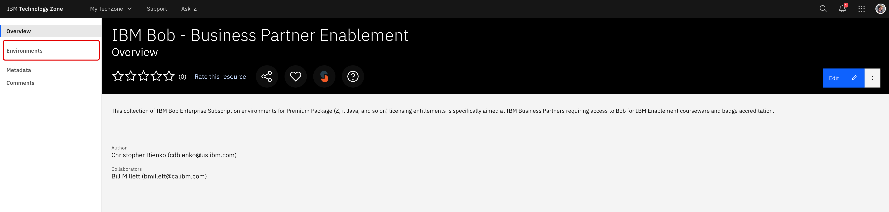{ width="600" }

    ---

    2. Four options will be available:

        - Request entitlement for IBM Bob Enterprise
        - *Request entitlement for IBM Bob Premium Package for i*
        - Request entitlement for IBM Bob Premium Package for Z
        - Request entitlement for IBM Bob Premium Package for Java

        Click the **Reserve it** button below the *Request entitlement for IBM Bob Premium Package for i* tile.

        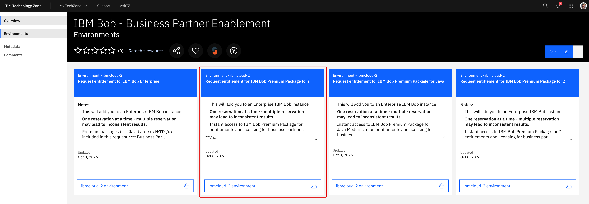{ width="600" }

    ---

    3. *Step 1: General* of the configuration process will ask you to specify a **Name** and **Description** for your reservation. When ready, click **Next** in the bottom-right corner to continue.

        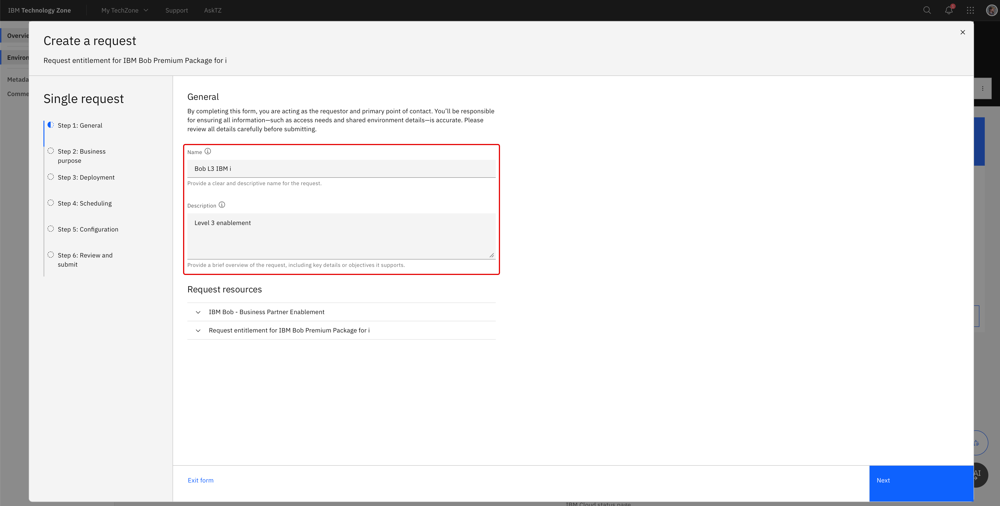{ width="600" }

    ---

    4. *Step 2: Business purpose* must be set to **Learning** in order to bypass the need for an opportunity number. If you mistakenly click the wrong option, or if the reservation system does not allow you to continue without an opportunity number, exit out from this page and try again. When ready, click **Next** to continue.

    ---

    5. *Step 3: Deployment* will ask you to specify the **Geography** for your deployment. Select the data center location that is closest to you. When ready, click **Next** to continue.

        { width="600" }

    ---

    6. *Step 4: Scheduling* will ask you to specify the go-live and termination dates for your deployment. Note that deployments can only be scheduled up to 12 hours of run-time before the instance is automatically deprovisioned. This is sufficient time to complete the hands-on lab materials. If you need additional time, you can provision a new instance using the same instructions provided within this lab guide. When ready, click **Next** to continue.

        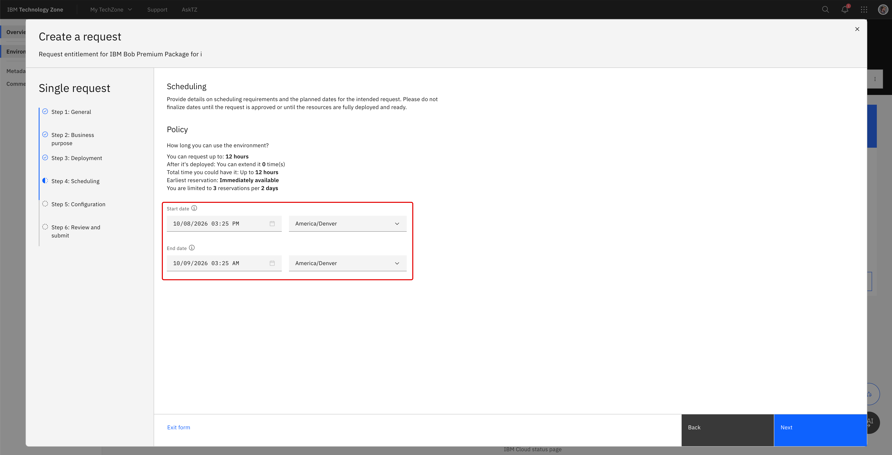{ width="600" }

    ---

    7. *Step 5: Configure* can be left **blank** (default state of *"There is nothing to configure here."*) When ready, click **Next** to continue.

        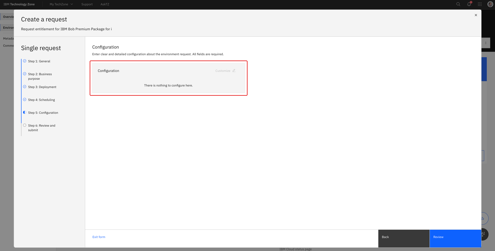{ width="600" }

    ---

    8. *Step 6: Review and submit* will ask you to review your configuration settings before submitting the request. Scroll down through your reservation details and, if you approve, check the **I agree to IBM Technology Zone's terms & conditions and user security policies.** box at the bottom of the page. When ready, click **Submit** to initiate the reservation request.

        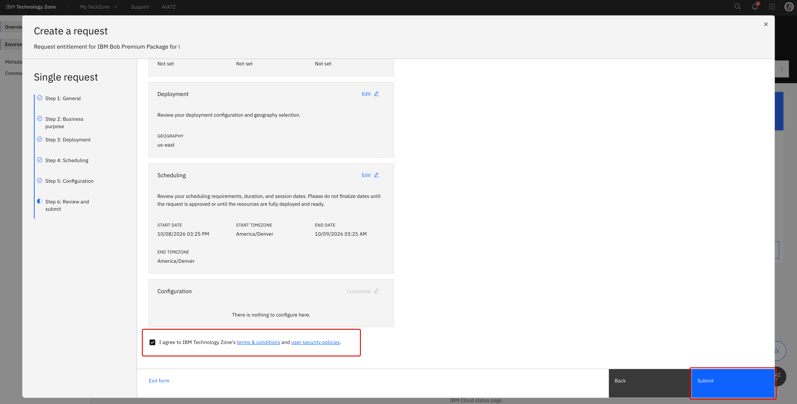{ width="600" }

    ---

    9. The web browser will redirect automatically to IBM Technology Zone's *My requests* dashboard. From this page, you can monitor and track the progression of your reservation request as it moves from `Scheduled` to `Provisioning` to `Ready`. **Wait** until the request is marked as `Ready` before advancing.

        Average deployment times are roughly **`5 minutes`** or less.

        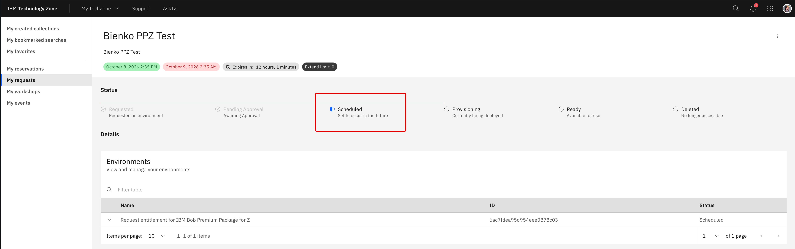{ width="600" }

        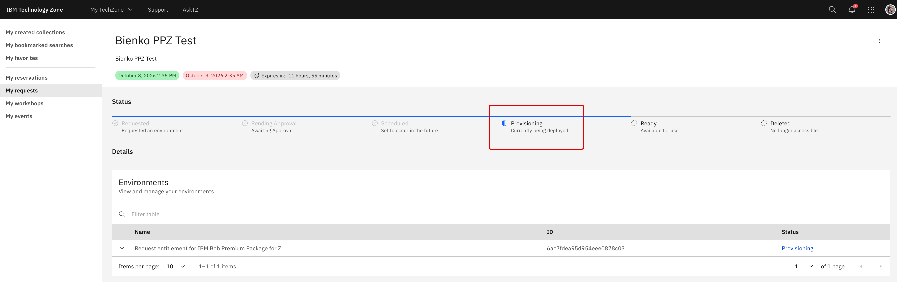{ width="600" }

        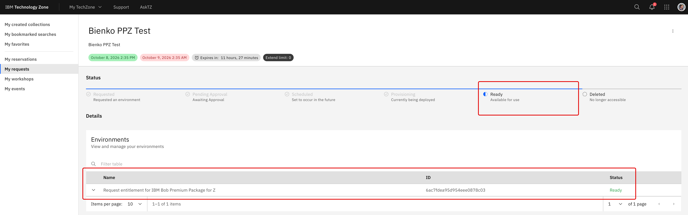{ width="600" }

    ---

    10. When the reservation is `Ready`, you will receive an email to your inbox providing you with a link to the environment **and** the same details will also be accessible via the *My requests* dashboard (where you were tracking the reservation request).

        Click either the **View your request** link in the email body *OR* click the arrow to the left of your reservation name on the *My requests* dashboard to expand details about the request.

        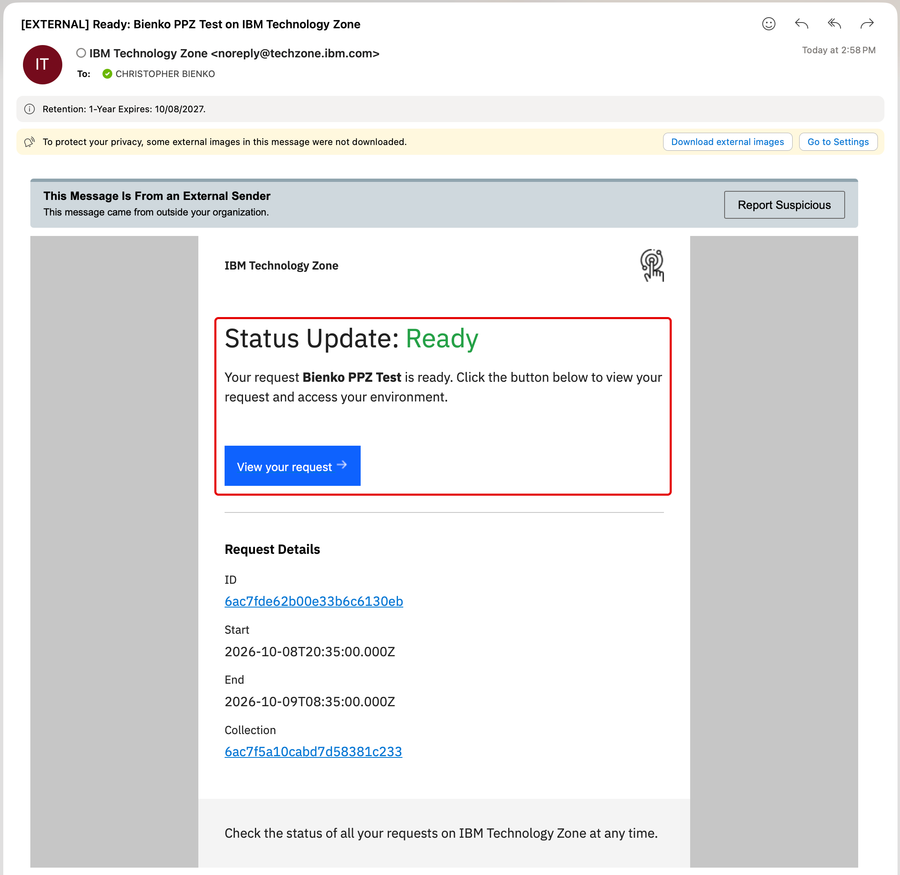{ width="600" }

        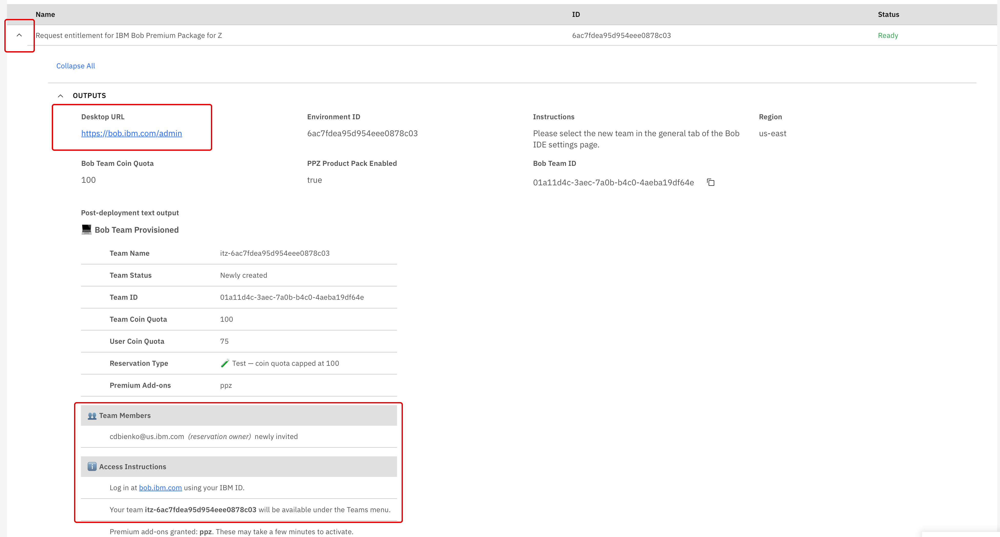{ width="600" }

    ---

    11. Both links will direct to the IBM Bob dashboard:

        !!! warning ""
            **URL:** **<a href="https://bob.ibm.com/admin" target="_blank">https://bob.ibm.com/admin</a>**

        Authenticate and log in using your **IBM ID**, which (since you should have previously registered for IBM Bob) will automatically be associated with your Bob account.

    ---

    12. The web browser will redirect to a welcome splash screen reading *"Welcome [your username]!"* where you are prompted to **Choose workspace**.

        Depending on how you previously registered for general access to IBM Bob, the default option below this may display text such as `IBM Internal` or `Free Trial` (or potentially something else).

        - Click the box below **Choose workspace** to open a drop-down menu
        - Your request via IBM Technology Zone for PPi entitlements will have added a new option to this list, similar to `TECHZONE-BobathonV2 (us-east)`. This entry is the PPi licensing entitlement that IBM Technology Zone provisioned for you
        - Select the `TECHZONE-BobathonV2 ...` option as your workspace and then continue with the login

        { width="600" }

    ---

    13. The web browser will automatically load into the IBM Bob dashboard.

        - Verify in the top-left corner that `TECHZONE-BobathonV2 ...` is selected for **Organization**
        - Click the **Subscription** tab to view details about your subscription, plan type, seats, and Bobcoins
        - Towards the bottom of the panel, under the **Premium packages** section, there will be an *IBM i* tile marked as `Active`: this confirms your IBM Bob account is now successfully linked (and entitled for use) with the IBM Technology Zone *Premium Package for i* license.

        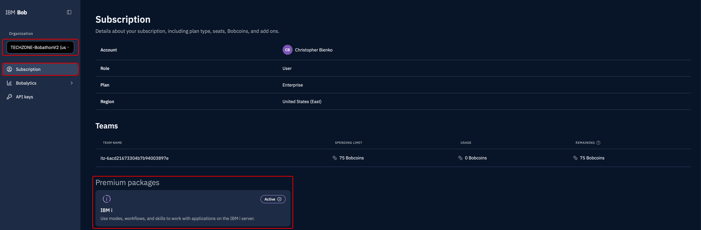{ width="600" }

---

## **iii. Install and authorize Bob Premium Package for i**

With your entitlements connected to your IBM Bob account, you will next need to install the **IBM Bob Premium Package for i** extension within the Bob IDE. The extension adds IBM i-specific modes, tools, skills, workflows and slash commands to the capabilities already present within Bob. Every module of this lab uses them.

---

1. In IBM Bob IDE, open the **Extensions** view (`Cmd+Shift+X` / `Ctrl+Shift+X`) and search for **`Premium Package`**.

    Locate the **IBM Bob Premium Package for i** tile (publisher: *IBM*) and click **Install**.

    <p align="left">
    
    </p>

---

2. A **"Do you trust the publisher 'IBM' and 2 others?"** dialog appears. Review the details, then click **Trust Publishers & Install** to proceed.

    Installation of the Premium Package and its bundled dependencies (including *Code for IBM i*) will complete in a few seconds.

    <p align="left">
    
    </p>

---

3. After the extension has installed, look towards the bottom-right corner of the Bob IDE interface. Along the bottom edge of the interface there will be an interactable button labelled **Bob Settings** — click this button to open the *Settings* panel.

    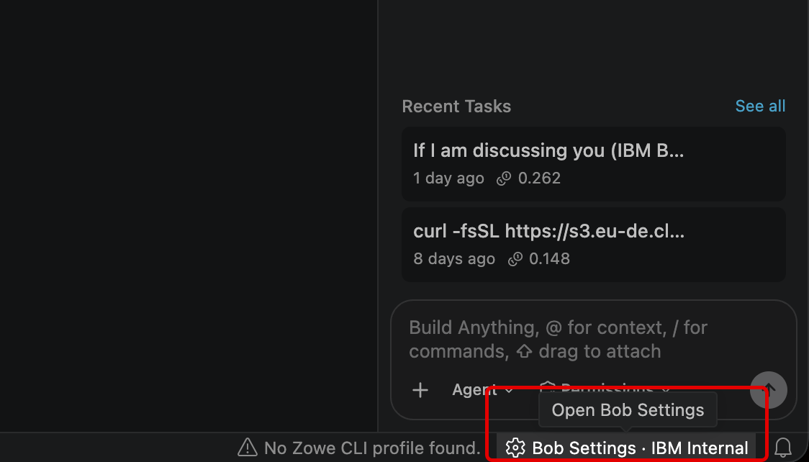{ width="600" }

---

4. From the *Settings* panel, make sure the **General** tab (left side) is the one being displayed.

    - Locate the **Team** setting, which by default at this stage might be set to either `IBM Internal`, `Trial`, or some other variation
    - Click the name of your **Team** to pull open a drop-down menu
    - Select the `TECHZONE-BobathonV2 ...` option to connect to your Premium Package entitlements

    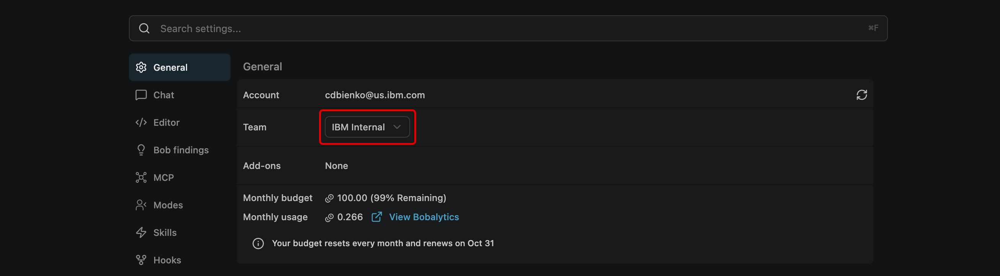{ width="600" }

    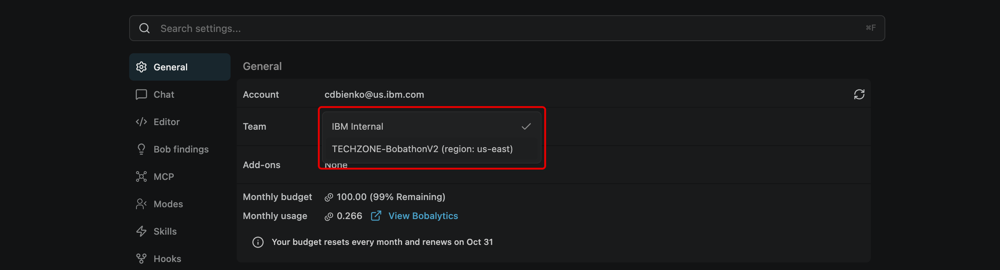{ width="600" }

---

5. Afterwards, further down the panel adjacent the **Add ons** setting, you should now see the `IBM Bob Premium Package for i` displayed.

    - Look further to the *right* of this setting to locate the **Install** button
    - Click **Install** to initiate an *Install addon* operation (this might seem redundant but it is a required activation within Settings to fully connect the Premium Package)
    - Wait a moment for a pop-up notification to appear in the bottom-right corner of the Bob IDE interface, similar to the one shown in the screenshot below
    - Bob IDE might request an application restart to implement the changes; if this is the case, **accept** and restart the IDE

    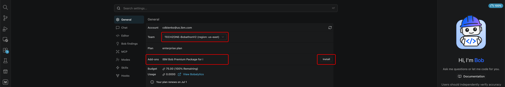{ width="600" }

    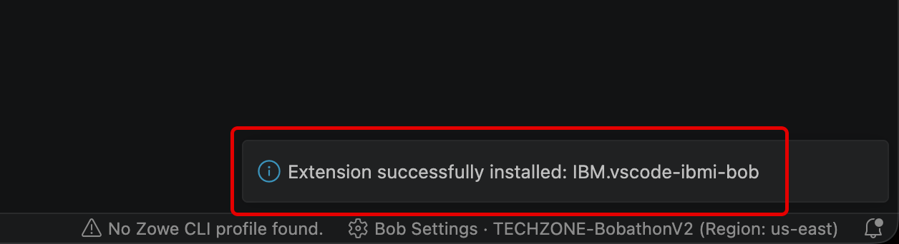{ width="600" }

---

6. At this stage, the Premium Package should both be fully authorized with your IBM Bob account and integrated with your Bob IDE. To verify, open the **Agentic Sidebar** and click the *Agent modes* selector button.

    Within the drop-down menu of *Agent modes*, you should now see IBM Bob Premium Package-specific modes that were previously unavailable: `IBM i Developer` and `IBM i Database`.

    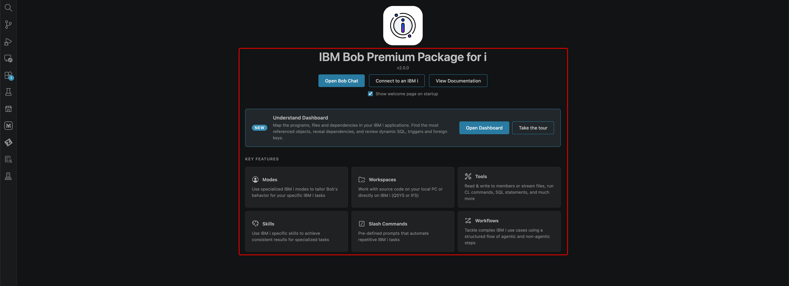{ width="600" }

    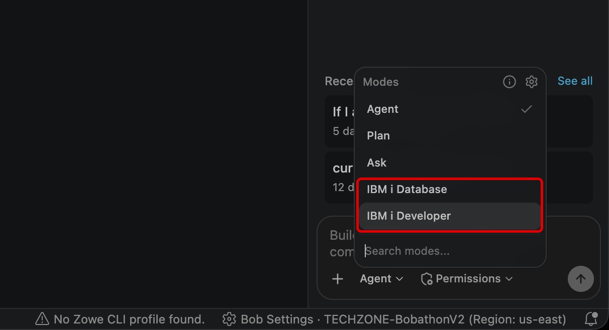{ width="600" }

---

## **iv. Install the IBM i Development Pack**

The Premium Package bundles *Code for IBM i*, which is enough to browse objects and edit source. The later modules lean on companion extensions from the Code for IBM i ecosystem as well: *Module 4* drives RPGUnit through the **IBM i Testing** extension, and the **Db2 for IBM i** extension gives you a place to run SQL statements yourself alongside the work of *Module 3*. Depending on the release of the Premium Package, some of these may already be present on your machine. The **IBM i Development Pack** is an extension pack maintained by the Code for IBM i team. It installs whichever are missing in one pass, together with the RPGLE, CL and COBOL language tooling and the display-file renderer.

---

1. In the **Extensions** view, search for **`IBM i Development Pack`**.

    Locate the **IBM i Development Pack** tile (publisher: *HalcyonTechLtd*, the Code for IBM i team) and click **Install**. The pack installs its member extensions in one pass; the count varies by release, so expect a dozen or so new entries under *Installed* when it finishes.

    !!! note "ALREADY INSTALLED?"
        If the tile already shows **Uninstall** instead of **Install**, the pack arrived with an earlier Code for IBM i installation on this machine and there is nothing further to do.

    <!-- SCREENSHOT: Extensions view with "IBM i Development Pack" selected and its Install button -->

---

2. If the Bob IDE prompts for a **Reload** (or a *Restart Extensions* notification appears in the bottom-right corner), accept it. The language tooling and the IBM i Testing view register on the next activation.

    Afterwards, search the Extensions view for **`IBM i Testing`** and confirm that it appears under *Installed*. That extension is the one *Module 4* checks for before it installs RPGUnit on the partition.

    <!-- SCREENSHOT: Extensions view showing IBM i Testing under Installed -->

---

## **v. Reserve the IBM i 7.6 virtual machine**

!!! warning "APPROVAL & PROVISIONING TIME"

    Once submitted, the request typically moves from *Scheduled* → *Provisioning* → *Ready* over the course of roughly 30–60 minutes. You will receive an email notification once the environment is fully deployed and available for use.

Before installing the Flight400 demo app, you will need an IBM i environment provisioned through [IBM Technology Zone](https://techzone.ibm.com/collection/techzone-certified-power-vs-base-vms){:target="_blank" rel="noopener noreferrer"}. The steps below walk you through requesting a *Certified PowerVS Base VM* running IBM i 7.6, which you will use throughout the remainder of the lab.

---

1. Begin by signing in with your **IBMid** on the IBM login page.

    Enter your IBMid in the field, press **Continue**, then complete the password prompt on the subsequent page.

    <p align="left">
    
    </p>

---

2. Open the **Certified PowerVS Base VMs** collection in IBM Technology Zone.

    Locate the **IBM i 7.6 IBM Cloud PowerVS VSI** tile and click the **ibmcloud-2 environment** button at the bottom of the tile.

    <p align="left">
    
    </p>

---

3. On **Step 1: General**, fill in the request details.

    - **Name:** `IBM i Modernization with Bob`
    - **Description:** `Hands-on labs to learn IBM i modernization using IBM Bob AI assistant`

    Then press **Next**.

    <p align="left">
    
    </p>

---

4. On **Step 2: Business purpose**, select **Learning** as the primary use.

    Leave the *Opportunity* fields blank and press **Next** to continue.

---

5. On **Step 3: Deployment**, confirm the pre-selected geography:

    !!! note ""
        `itz-shared-power - americas - us-east region - wdc07 datacenter`

    Press **Next** to continue.

    <p align="left">
    
    </p>

---

6. On **Step 4: Scheduling**, review the default **Start date** and **End date**. The environment can be reserved for up to **12 hours** per request.

    Adjust the dates if needed, then press **Next**.

    <p align="left">
    
    </p>

---

7. On **Step 5: Configuration**, review the default VM specs:

    | Setting | Value |
    |---------|-------|
    | **CPU** | 0.5 |
    | **Memory** | 4 GB |
    | **Boot volume** | 50 GB |
    | **Secondary disk** | None |
    | **Network interface** | Public |

    These defaults are sufficient for the lab. Press **Review**.

    <p align="left">
    
    </p>

---

8. On **Step 6: Review and submit**, verify all details, then tick the checkbox to agree to IBM Technology Zone's **terms & conditions** and **user security policies**.

    Press **Submit**.

    <p align="left">
    
    </p>

---

9. You will land on a **Success** confirmation page displaying your **Request ID** — save this for reference.

    Press **Track my request** to monitor the provisioning status.

    <p align="left">
    
    </p>

---

10. On the **My requests** page, you will see your newly submitted **IBM i Modernization with Bob** request with a **Scheduled** status.

    The environment will progress through *Scheduled → Provisioning → Ready* automatically. You can leave this page and return later — an email will notify you when it's ready.

    <p align="left">
    
    </p>

---

11. Once the status changes to **Ready**, return to the request page and click the **expand arrow** (the ++v++ icon) to the left of the environment name to reveal the connection details.

    <p align="left">
    
    </p>

---

12. Within the expanded **Outputs** panel, capture the following — you will need them to SSH into your IBM i VM in the next section:

    - **Deployment user name**
    - **Virtual machine 1 public IP address**
    - **Deployment SSH private key** — click **Download** and store the key file securely

    <p align="left">
    
    </p>

---

## **vi. Download the lab assets**

---

While your IBM i environment provisions, download the *Flight400* distribution — the single, production-style application that every module in this lab builds upon.

1. **Download** the Flight400 project files from the links below and save them to your computer:
    
    !!! warning ""
        - [FLIGHT400.FILE](https://ibm.seismic.com/Link/Content/DCW2BP9gdHGpX8THhd2fCgXhMg93){:target="_blank"}
        - [Install-Flight400.sql](https://ibm.seismic.com/Link/Content/DCDpHPGJ6GjjT8QBHqb24JH7X2XP){:target="_blank"}

---

2. Keep both files somewhere convenient for the time being, as the next section will have you create the workspace folder they will reside in (alongside the SSH key you downloaded from IBM Technology Zone.)

---

## **vii. Set up the Project workspace**

!!! success "PREREQUISITES"

    **You should have the following in place before starting this section:**

    - **IBM Bob IDE** — installed and authenticated (from your registration path)
    - **`ssh_private_key.pem`** — downloaded from IBM Technology Zone (<a href="https://bienko.github.io/bob-ppi/setup/#v-reserve-the-ibm-i-76-virtual-machine" target="_blank">section v</a>)
    - **`FLGHT400.FILE`** and **`Install-Flight400.sql`** — downloaded from the Flight400 distribution package (<a href="https://bienko.github.io/bob-ppi/setup/#vi-download-the-lab-assets" target="_blank">section vi</a>)

With your IBM i environment provisioned and the Deployment SSH private key downloaded, the next step is to prepare a local workspace, open it in **IBM Bob IDE**, and lock down permissions on the SSH key so it can be used for authentication.

---

1. On your laptop, create a local folder — for example `~/ibmiflight400` — and move the three files into it: **`FLGHT400.FILE`**, **`Install-Flight400.sql`**, and **`ssh_private_key.pem`**.

    Confirm all three files appear side-by-side in the folder before continuing.

    <p align="left">
    
    </p>

---

2. Open **IBM Bob IDE**. In the Explorer view, click **Open Folder** to open your local workspace.

    <p align="left">
    
    </p>

---

3. In the file dialog, navigate to the folder you just created (`ibmiflight400`), select it, and press **Open**.

    Bob IDE will now treat this folder as your workspace for the remainder of the lab.

    <p align="left">
    
    </p>

---

4. From the top menu bar, select **Terminal → New Terminal** to open an integrated terminal at the root of your workspace.

    <p align="left">
    
    </p>

---

5. In the terminal, tighten the permissions on the SSH private key so it can be used for authentication. Copy and paste the following command, then press ++enter++:

    ``` bash
    chmod 600 ssh_private_key.pem
    ```

    !!! note ""

        SSH will refuse to use a private key that is readable by other users on the system. `chmod 600` restricts read and write access to only your user account, satisfying SSH's security check.

    <p align="left">
    
    </p>

---

## **viii. Connect to the IBM i LPAR**

With the *IBM Bob Premium Package for i* extension now installed, you can next point Bob to your provisioned IBM i LPAR using the connection details captured earlier.

---

1. On the **IBM Bob Premium Package for i** welcome page, click **Connect to an IBM i**.

    <p align="left">
    
    </p>

---

2. In the **IBM i Login** form, fill in the connection details:

    - **Connection Name:** `IBM i Modernization`
    - **Host or IP Address:** the *Virtual machine 1 public IP address* from <a href="https://bienko.github.io/bob-ppi/setup/#v-reserve-the-ibm-i-76-virtual-machine" target="_blank">section v</a>
    - **Port (SSH):** `22` (default)
    - **Username:** `ITZUSER`

    Leave the **Password** field empty — authentication will use the SSH private key instead.

    <p align="left">
    
    </p>

---

3. Scroll down to the **Private Key** section and click **Select File**.

    In the file picker, navigate to your workspace folder, select **`ssh_private_key.pem`**, and press **Open**.

    <p align="left">
    
    </p>

---

4. Confirm the Private Key path is now populated in the login form, then press **Connect** at the bottom of the form.

    <p align="left">
    
    </p>

---

5. A **Directory permissions** dialog may appear — *"Security recommendation: Update directory permissions?"* — asking to create `/home/ITZUSER/.vscode` with permissions `700`.

    Click **Yes** to accept the recommendation.

    <p align="left">
    
    </p>

---

6. Once connected, the IBM i sidebar populates with **User Library List** (`QGPL`, `QTEMP`), **Object Browser**, and **IFS Browser** entries. This is confirmation that Bob is talking to your LPAR.

    Dismiss the transient notifications on the right (SQL job, local actions, deploy directory prompts) and close the welcome tab.

    <p align="left">
    
    </p>

---

## **ix. Enable the 5250 terminal**

Certified PowerVS Base VMs ship without the **`tn5250`** package installed, so a 5250 terminal session from Bob IDE will initially fail. Rather than SSH-ing in and installing it by hand, you will ask Bob itself to install `tn5250` on the LPAR. The rest of the lab uses Bob in the same way.

---

1. Open the Bob chat panel. At the bottom of the chat, expand the **mode selector** and choose **IBM i Developer**.

    This mode gives Bob the tools and skills needed to run CL commands, install PASE packages, and edit your user profile on the LPAR.

    <p align="left">
    
    </p>

---

2. Click into the prompt field and paste the following request (press ++cmd+v++ or alternatively ++ctrl+v++):

    ``` text
    I'm getting the error "5250 terminal is not supported. Please install tn5250 via yum on the remote system." in the Code for IBM i VS Code extension. Please install tn5250 on my remote IBM i system, make sure it's in the default PATH, and set up my user profile so it's available in login shells. After that, tell me to reconnect using "Connect and Reload Server Settings" in VS Code.
    ```

    Press ++return++ to execute the instruction.

    <p align="left">
    
    </p>

---

3. Bob will perform the `yum install tn5250-0.17.6-1` request to update `/home/ITZUSER/.profile` and `/QOpenSys/etc/profile.local` — such that `/QOpenSys/pkgs/bin` is on the `PATH` for every login shell used after the fact.

    When Bob finishes, click the **disconnect** button highlighted in the bottom-left status bar to close the current session with your LPAR.

    <p align="left">
    
    </p>

---

4. In the IBM i sidebar, right-click your server (**IBM i Modernization**) and choose **Connect and Reload Server Settings**.

    This forces the extension to re-read the remote environment — including the updated `PATH` — so that the `tn5250` binary Bob just installed is picked up.

    <p align="left">
    
    </p>

---

5. Within the Bob IDE status bar (bottom of the window), **hover over** the *gear icon* to reveal the connection pop-up.

    From the options presented, click **Terminals** to open a new Terminal console session on the LPAR.

    <p align="left">
    
    </p>

---

6. When prompted **"Select a terminal type"**, choose **5250**.

    !!! note ""
        The **PASE** option gives you a Unix-style shell on the LPAR — useful for running `yum`, editing files, and inspecting IFS content. The **5250** option gives you the classic green-screen IBM i session used by RPG applications like FLIGHT400. *Module 6* relies on the PASE side as well, since that is where Node.js runs.

    <p align="left">
    
    </p>

---

7. A new **IBM i 5250: IBM i Modernization** tab opens, showing the classic **Sign On** screen — *System*, *Subsystem*, *Display*, and *User* fields ready for input.

    You now have a working 5250 terminal directly inside Bob IDE, alongside a PASE shell in the bottom panel.

    <p align="left">
    
    </p>

---

## **x. Uploading the Flight400 files to the IFS**

Bob is now connected to your LPAR, but the Flight400 save file and install script still live only on your laptop. Use Bob IDE's **Deploy Selected Files** feature to push them into the IFS on your LPAR, where the install script can be executed.

---

1. From the Activity Bar tabs along the left side of the Bob IDE, click the **Explorer** icon to switch back to your local workspace view.

    You should see `FLGHT400.FILE` and `Install-Flight400.sql` at the top of the tree.

    <p align="left">
    
    </p>

---

2. Select both **`FLGHT400.FILE`** and **`Install-Flight400.sql`** (hold ++cmd++ / ++ctrl++ and click each file), then right-click the selection and choose **Deploy Selected Files**.

    <p align="left">
    
    </p>

---

3. On the first deploy, a notification will appear in the bottom-right: *"Chosen location … is not configured for deployment."*

    - Click **Set deploy location** to configure the target IFS directory
    - **Accept** the suggested path (typically `/home/ITZUSER/builds/ibmiflight400`)
    - This becomes the IFS directory that mirrors your local workspace

    <p align="left">
    
    </p>

---

4. In the Activity Bar, click the **IBM i** icon to switch to the IBM i sidebar, where you can browse the LPAR.

    <p align="left">
    
    </p>

---

5. Click the **refresh** icon on the **IFS Browser** header to reload the tree so the newly deployed files show up.

    <p align="left">
    
    </p>

---

6. Expand `/home/ITZUSER` → **`builds`** → **`ibmiflight400`**.

    Confirm that both `FLGHT400.FILE` and `Install-Flight400.sql` are now present on the LPAR.

    <p align="left">
    
    </p>

---

## **xi. Restoring the FLGHT400 library**

With the save file staged in the IFS, the next step is to run the SQL install script. The script uses IBM i services to create a save file object in QSYS, copy the IFS save file into it, and restore the library. Before running it, you will point the script at the exact IFS path Bob just deployed.

---

1. In the **IFS Browser**, right-click **`FLGHT400.FILE`** and choose **Copy Path**. You will paste this into the install script in a moment.

    <p align="left">
    
    </p>

---

2. Switch back to the **Explorer** view via the Activity Bar.

    <p align="left">
    
    </p>

---

3. Open **`Install-Flight400.sql`** in the editor and locate the three configuration variables near the top of the `BEGIN` block:

    ``` sql
    DECLARE v_ifs_path  VARCHAR(256) DEFAULT '/home/BENOIT/builds/…';
    DECLARE v_rst_lib   VARCHAR(10)  DEFAULT 'FLGHT400';   -- target library
    DECLARE v_owner     VARCHAR(10)  DEFAULT NULL;         -- set to a profile …
    ```

    <p align="left">
    
    </p>

---

4. Replace the default `v_ifs_path` string with the path you copied in step 1.

    - The new string should look like `/home/ITZUSER/builds/ibmiflight400/FLGHT400.FILE`
    - Leave `v_rst_lib` as `FLGHT400` and `v_owner` as `NULL`
    - **Save** the file (++cmd+s++ / ++ctrl+s++) and then **close** the editor tab

    <p align="left">
    
    </p>

---

5. Switch back to the **IBM i** sidebar and locate **`Install-Flight400.sql`** in the IFS Browser under `/home/ITZUSER/builds/ibmiflight400`.

    !!! warning ""

        Because you edited the file locally, redeploy it (right-click → **Deploy Selected Files**) so the LPAR has the updated version before running it. If the IFS copy is out of date, the script will use the wrong path.

    <p align="left">
    
    </p>

---

6. Right-click **`Install-Flight400.sql`** in the IFS Browser and choose **Run Action…**.

    <p align="left">
    
    </p>

---

7. From the action selector at the top of the window, choose **Run SQL Statements (RUNSQLSTM)**.

    <p align="left">
    
    </p>

---

8. The integrated terminal will open and display the RUNSQLSTM output. Wait for the message summary to show **`0 level severity errors found in source`**, followed by `***** END OF LISTING *****`.

    !!! success ""
        The **FLGHT400** library — programs, source members, and database files — is now restored on your LPAR.

    <p align="left">
    
    </p>

---

## **xii. Adding FLGHT400 to your library list**

The library exists on the LPAR, but Bob won't find its objects by default. IBM i only searches libraries that appear in your **library list**. Add `FLGHT400` to your list so every subsequent lookup, filter, and Bob prompt can reach the application.

---

1. In the IBM i sidebar, hover over the **User Library List** header and click the **+** (Add library) icon.

    <p align="left">
    
    </p>

---

2. In the prompt at the top of the window (*"Library to add"*), type **`FLGHT400`**.

    <p align="left">
    
    </p>

---

3. Press ++enter++ to confirm. **`FLGHT400 (*PROD)`** now appears in your User Library List alongside `QGPL` and `QTEMP`.

    <p align="left">
    
    </p>

---

## **xiii. You're ready to proceed**

!!! success ""
    **Setup is complete if:**
    
    - IBM Bob is authenticated and the *Add ons* setting lists *IBM Bob Premium Package for i*
    - The Agentic Sidebar's mode selector lists **IBM i Developer** and **IBM i Database** alongside Agent, Plan and Ask
    - The Extensions view lists the **IBM i Development Pack** and its member extensions (among them *IBM i Testing*) under *Installed*
    - The IBM i LPAR is provisioned and Bob is connected to it as `ITZUSER`
    - Both PASE and 5250 terminals are working from inside the IDE
    - The `FLGHT400` library is restored and appears in your User Library List alongside `QGPL` and `QTEMP`

You are ready to begin the hands-on work.

Onward to **[Module 1 | Analyze](1-1.md){:target="_blank"}**. You will begin by exploring FLIGHT400 in the Object Browser and writing Bob's `AGENTS` member with `/init`. You will then scan the application into the Understand Dashboard and produce an architecture overview and an entity relationship diagram from the live system. Each later module builds on the documentation and the scan you produce there.

---